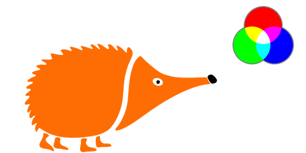

# 2.9 Mezclamos colores

{ .img-cabecera }

## 1. Qué vamos a hacer

Vamos a hacer que el **LED RGB** de la placa recorra, uno detrás de otro, un montón de colores distintos mezclando sus tres colores básicos: **rojo**, **verde** y **azul**. A la vez, veremos en el **Monitor serie** la mezcla que forma cada color.

### 1.1 Qué vamos a aprender

* A utilizar el **LED RGB** y a **mezclar** sus tres colores (rojo, verde y azul) para conseguir otros.
* A ajustar la **intensidad** de cada color con valores de `0` a `255` mediante **PWM** con `analogWrite`, como el brillo del LED verde en [Brillo LED](05-brillo-led.md).
* A poner un bucle **dentro de otro** (bucles **anidados**) para recorrer todas las combinaciones.

### 1.2 Qué vamos a usar

#### Componentes

* **LED RGB (pines 9, 5 y 6):** Componente que tiene dentro tres LED: uno **rojo** (R, *Red*, pin 9), uno **verde** (G, *Green*, pin 5) y uno **azul** (B, *Blue*, pin 6). Al mezclar la luz de los tres podemos conseguir más de 16 millones de colores.

{ .img-lupa }

#### Programación

Los pines del LED RGB son de tipo **Digital/Analógico** (ver la tabla de pines de la [Introducción](../01-introduccion.md)), así que con `analogWrite` damos a cada color un valor entre `0` (apagado) y `255` (máxima intensidad), como hicimos con el LED verde en [Brillo LED](05-brillo-led.md). Por ejemplo, el **naranja Echidna** es mucho rojo (`254`), algo de verde (`109`) y casi nada de azul (`4`).

Ya conoces el bucle `for` del proyecto [Brillo LED](05-brillo-led.md). Allí la variable sumaba `1` en cada vuelta; aquí sumará `paso`, así que cada color irá de `paso` en `paso`. Para probar **todas las combinaciones** de colores, ponemos un bucle **dentro de otro** (bucles **anidados**): por cada vuelta del bucle de fuera, el de dentro da todas sus vueltas.

```arduino
for (int rojo = 0; rojo <= 255; rojo = rojo + paso) {
  for (int verde = 0; verde <= 255; verde = verde + paso) {
    // se repite para cada pareja de rojo y verde
  }
}
```

Si cada bucle da 6 vueltas, lo que hay dentro del segundo se repite 6 × 6 = 36 veces, una por cada pareja de valores. Nuestro programa usa tres bucles anidados, uno por color.

## 2. Programamos

El programa usa tres bucles `for`, uno dentro de otro: uno para el rojo, otro para el verde y otro para el azul. Cada color toma los valores `0`, `51`, `102`, `153`, `204` y `255`, y el programa prueba **todas las combinaciones**: 6 × 6 × 6 = **216 colores**. Cada color se ve durante una décima de segundo, así que la vuelta completa dura unos 22 segundos.

Escribe el siguiente código en Arduino IDE y cárgalo en la placa:

```arduino linenums="1"
// Mezclamos colores: recorre los colores del LED RGB con tres bucles for anidados

const int rgbRojo = 9;   // LED RGB: color rojo en el pin 9
const int rgbVerde = 5;  // LED RGB: color verde en el pin 5
const int rgbAzul = 6;   // LED RGB: color azul en el pin 6

const int paso = 51;     // cuánto sube cada color en cada vuelta (0, 51, 102, 153, 204, 255)
const int espera = 100;  // tiempo que se ve cada color, en milisegundos

void setup() {
  pinMode(rgbRojo, OUTPUT);  // los tres colores del LED RGB son salidas
  pinMode(rgbVerde, OUTPUT);
  pinMode(rgbAzul, OUTPUT);
  Serial.begin(9600);        // para ver en el Monitor serie la mezcla de cada color
}

void loop() {
  for (int rojo = 0; rojo <= 255; rojo = rojo + paso) {
    for (int verde = 0; verde <= 255; verde = verde + paso) {
      for (int azul = 0; azul <= 255; azul = azul + paso) {
        // mezcla los tres colores
        analogWrite(rgbRojo, rojo);
        analogWrite(rgbVerde, verde);
        analogWrite(rgbAzul, azul);

        // muestra la mezcla en el Monitor serie
        Serial.print(rojo);
        Serial.print("  ");
        Serial.print(verde);
        Serial.print("  ");
        Serial.println(azul);

        delay(espera);
      }
    }
  }
}
```

Después de cargar el programa, abre el **Monitor serie** (**Herramientas > Monitor Serie**, a **9600 baudios**) para ver los valores de rojo, verde y azul de cada color.

**Cómo funciona**:

**Las constantes** (líneas 3 a 8): guardan los pines de los tres colores del LED RGB, el **paso** (cuánto sube cada color de una vuelta a la siguiente) y la **espera** (cuánto tiempo se ve cada color).

**La función `setup()`** (líneas 10 a 15): configura los tres pines del LED RGB como **salidas** y abre la comunicación con el ordenador con `Serial.begin(9600)`.

**La función `loop()`** (líneas 17 a 37): tiene los tres bucles `for` anidados. Las variables `rojo`, `verde` y `azul` se crean dentro de cada `for` y cuentan los valores de cada color. Dentro del bucle más interior, `analogWrite` enciende cada color con su valor, `Serial.print` escribe la mezcla en el Monitor serie y `delay` deja ver el color.

Los bucles anidados funcionan como el cuentakilómetros de un coche: el bucle de **dentro** (el azul) es el que gira más rápido. Cada vez que el azul termina sus seis valores, el verde sube un paso; y cada vez que el verde termina los suyos, sube el rojo:

```
PARA cada valor del rojo (0, 51, ... 255):
    PARA cada valor del verde (0, 51, ... 255):
        PARA cada valor del azul (0, 51, ... 255):
            --> Enciende el LED RGB con esa mezcla.
            --> Escribe la mezcla en el Monitor serie.
            --> Espera 100 milisegundos.
```

Cuando los tres bucles terminan, `loop()` vuelve a empezar y el recorrido de colores se repite.

## 3. Mejóralo

Prueba a realizar algunas de las siguientes modificaciones al proyecto:

1. **Más colores:** Cambia las constantes del programa para que el LED RGB recorra **muchos más colores** y comprueba cuánto dura ahora la vuelta completa.

    **Pista:** cuanto más pequeño sea `paso`, más valores toma cada color y más combinaciones hay. Para que cada color llegue justo a `255`, elige un paso que divida exactamente a `255`, como `85`, `51`, `17`, `15` o `5`. Si hay muchos colores, baja también la `espera` para que la vuelta no dure demasiado.

2. **De rojo a azul:** Haz que el LED RGB pase poco a poco del **rojo** al **azul**, pasando por los morados, y después vuelva del azul al rojo.

    **Pista:** basta con un `for` para cada sentido (no anidados). Mientras el azul sube, el rojo baja: si el azul vale `valor`, el rojo vale `255 - valor`, así que entre los dos siempre suman `255`. Usa un paso pequeño (`5`) y una espera corta (`30`) para que el cambio sea suave.

3. **Termómetro de colores:** Usa el **sensor de temperatura** para que el LED RGB cambie de color según la temperatura: **azul** si hace frío (menos de `20` ºC), **verde** si la temperatura es agradable y **rojo** si hace calor (más de `28` ºC).

    **Pista:** lee la temperatura como en el proyecto [El echidna dice la temperatura](08-echidna-dice-temperatura.md) y usa `if`, `else if` y `else`, como en el medidor de luz del [Interruptor crepuscular](06-interruptor-crepuscular.md). Para cada color, da `255` al que quieres encender y `0` a los otros dos con `analogWrite`.
