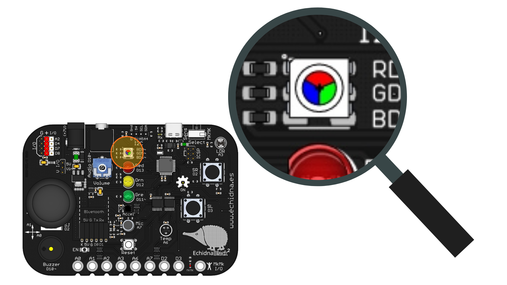
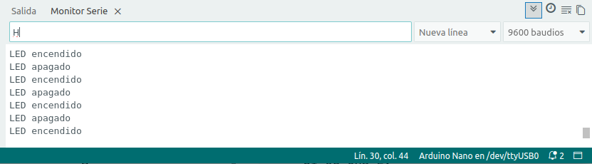

# 2.13 Control desde el ordenador

{ .img-cabecera }

## 1. Qué vamos a hacer

Vamos a usar el teclado del ordenador como un **mando a distancia**: escribiendo una **H** en el **Monitor serie**, el **LED RGB** se encenderá en color blanco, y escribiendo una **L**, se apagará. La placa nos contestará en el Monitor serie para confirmar que ha recibido la orden.

### 1.1 Qué vamos a aprender

* Que el **Monitor serie** no solo sirve para que la placa nos envíe datos, sino también para **enviarle órdenes** desde el ordenador.
* A comprobar si han llegado datos con `Serial.available()` y a leerlos con `Serial.read()`.
* A guardar un **carácter** en una variable de tipo `char` y a compararlo con una letra.

### 1.2 Qué vamos a usar

#### Componentes

* **LED RGB (pines 9, 5 y 6):** Con sus tres colores encendidos a la vez da luz **blanca**.
* **Ordenador conectado por el cable USB:** Desde el Monitor serie de Arduino IDE escribiremos las órdenes.

{ .img-lupa }

#### Programación

En el proyecto [El echidna dice la temperatura](08-echidna-dice-temperatura.md) la placa enviaba mensajes al ordenador con `Serial.print`. La comunicación también funciona al revés: lo que escribimos en el Monitor serie llega a la placa **carácter a carácter** y espera guardado hasta que el programa lo lee. Para eso usamos dos funciones:

* `Serial.available()`: dice cuántos caracteres han llegado y están esperando a ser leídos. Si es mayor que `0`, hay algo que leer.
* `Serial.read()`: lee el primero de los caracteres que están esperando.

El carácter leído lo guardamos en una variable de tipo **`char`**, que guarda un carácter, y lo comparamos con una letra escrita entre comillas **simples**: `if (letra == 'H')`.

Para enviar una orden, abre el Monitor serie (**Herramientas > Monitor Serie**, a **9600 baudios**), escribe la letra en la caja de texto de la parte superior y pulsa **Intro**. Fíjate en que `'H'` y `'h'` son caracteres distintos: escribe las letras en mayúsculas.



## 2. Programamos

El programa comprueba continuamente si ha llegado algún carácter desde el ordenador. Si ha llegado, lo lee: con una **H** enciende los tres colores del LED RGB y con una **L** los apaga. Cualquier otro carácter no hace nada.

Escribe el siguiente código en Arduino IDE y cárgalo en la placa:

```arduino linenums="1"
// Control desde el ordenador: H enciende el LED RGB en blanco y L lo apaga

const int rgbRojo = 9;   // LED RGB: color rojo en el pin 9
const int rgbVerde = 5;  // LED RGB: color verde en el pin 5
const int rgbAzul = 6;   // LED RGB: color azul en el pin 6

char letra = ' ';  // guarda la letra que llega del ordenador

void setup() {
  pinMode(rgbRojo, OUTPUT);  // los tres colores del LED RGB son salidas
  pinMode(rgbVerde, OUTPUT);
  pinMode(rgbAzul, OUTPUT);
  Serial.begin(9600);        // abre la comunicación a 9600 baudios
}

void loop() {
  // ¿ha llegado alguna letra desde el ordenador?
  if (Serial.available() > 0) {
    letra = Serial.read();  // lee la letra

    if (letra == 'H') {
      // H (de HIGH): enciende los tres colores, luz blanca
      digitalWrite(rgbRojo, HIGH);
      digitalWrite(rgbVerde, HIGH);
      digitalWrite(rgbAzul, HIGH);
      Serial.println("LED encendido");
    }

    if (letra == 'L') {
      // L (de LOW): apaga los tres colores
      digitalWrite(rgbRojo, LOW);
      digitalWrite(rgbVerde, LOW);
      digitalWrite(rgbAzul, LOW);
      Serial.println("LED apagado");
    }
  }
}
```

**Cómo funciona**:

**Las constantes** (líneas 3 a 5): guardan los pines de los tres colores del LED RGB.

**La variable** (línea 7): `letra` es de tipo `char` y guarda el carácter que llega del ordenador.

**La función `setup()`** (líneas 9 a 14): configura los pines del LED RGB como **salidas** y abre la comunicación con el ordenador con `Serial.begin(9600)`.

**La función `loop()`** (líneas 16 a 37): con `Serial.available() > 0` comprueba si ha llegado algo. Si no ha llegado nada, no hace nada y vuelve a empezar; si ha llegado, lee el carácter con `Serial.read()` y lo compara con las dos órdenes:

```
SI ha llegado algún carácter:
    --> Lo lee y lo guarda en letra.
    SI es una H:
        --> Enciende el LED RGB en blanco y contesta «LED encendido».
    SI es una L:
        --> Apaga el LED RGB y contesta «LED apagado».
```

Las letras **H** y **L** recuerdan a `HIGH` y `LOW`. Los demás caracteres se leen, pero no hacen nada; por ejemplo, el **salto de línea** que el Monitor serie puede enviar al pulsar Intro.

## 3. Mejóralo

Prueba a realizar algunas de las siguientes modificaciones al proyecto:

1. **Elige el color:** Añade tres órdenes más: con la **R** se enciende solo el rojo, con la **G**, solo el verde, y con la **B**, solo el azul (*Red*, *Green* y *Blue* en inglés).

    **Pista:** añade un `if` para cada letra, como los de la `H` y la `L`. En cada uno, enciende el color que corresponde y apaga los otros dos, y contesta con un mensaje.

2. **Brillo desde el teclado:** Haz que, al escribir un número de `0` a `255` terminado en `>` (por ejemplo, `128>`), el LED RGB se encienda en blanco con ese **brillo**.

    **Pista:** los números también llegan **carácter a carácter**: `128` llega como `'1'`, `'2'` y `'8'`. Para saber si un carácter es una cifra, comprueba `letra >= '0' && letra <= '9'`, y para convertirlo en su valor, réstale `'0'` (`'8' - '0'` vale `8`). Ve juntando las cifras en una variable `numero` con `numero = numero * 10 + (letra - '0')`: `1`, después `12` y después `128`. Cuando llegue el `>`, usa el número como brillo con `analogWrite` y vuelve a poner `numero` a `0` para el siguiente.

3. **Color a la carta:** Elige el color exacto del LED RGB escribiendo la intensidad de cada color seguida de su letra: `r` para el rojo, `g` para el verde y `b` para el azul. Por ejemplo, `254r109g4b` pone el LED del **naranja Echidna** del proyecto [Mezclamos colores](09-mezclamos-colores.md).

    **Pista:** parte de la mejora anterior. En lugar de un solo `>`, ahora hay tres letras que terminan el número: cada una guarda `numero` en la variable de su color (`rojo`, `verde` o `azul`) y lo vuelve a poner a `0`. Al final de `loop()`, enciende cada color con su valor.

**Para saber más:** estos programas también sirven para controlar la placa por **Bluetooth**. Si conectas un módulo Bluetooth al conector **Bluetooth** de la placa, las órdenes pueden llegar desde un móvil o una tableta, por ejemplo, con una aplicación hecha con **App Inventor**, y el programa las lee igual, con `Serial.available()` y `Serial.read()`. El módulo usa los mismos pines del puerto serie que el cable USB (`D0` y `D1`), así que desconéctalo mientras cargas un programa.
